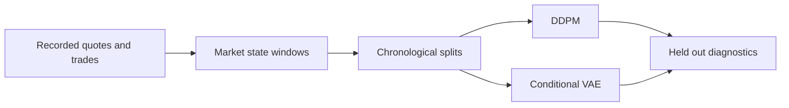
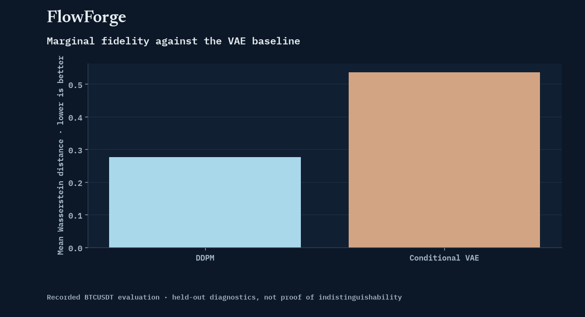

<p align="center"></p>

<h1 align="center">FlowForge</h1>

<p align="center">
  <a href="https://github.com/FaiyazEnayet/FlowForge/actions/workflows/ci.yml"></a>
  
  
  
</p>

<p align="center">
  <a href="https://faiyazenayet.github.io/FlowForge/docs/dashboard.html"></a>
  <a href="#method"></a>
  <a href="#run-locally"></a>
</p>

FlowForge generates short market-state sequences from recorded BTCUSDT data. The central question is whether a model can reproduce observed market behavior, not whether its output merely looks plausible.


<p align="center"><a href="https://faiyazenayet.github.io/FlowForge/docs/dashboard.html"></a></p>


Useful synthetic market data must preserve more than a plausible price trace. The sequence explorer connects local behavior with distributional distances and temporal dependence, making it easier to spot a generator that matches marginal statistics while missing market dynamics. Real and generated windows are independently sampled and compared by their relative time offsets.

## Explore

- Select observed and generated windows independently and inspect them at a synchronized time cursor.
- Compare midprice, spread and imbalance without presenting synthetic sequences as real observations.
- Read marginal fidelity, discriminator and temporal diagnostics together.

## Method

Top-of-book quotes and signed trade flow become standardized windows. A regime-conditioned DDPM is evaluated against a conditional VAE using held-out discriminator tests, feature distributions, temporal autocorrelation and downstream prediction.

## Evidence at a glance

| Scope | Recorded result or contract |
| :--- | :--- |
| Recorded data | 14,377 seconds across eight sessions (3.99 hours, one BTCUSDT recording span) |
| Train / validation / test windows | 996 / 168 / 168 |
| Mean Wasserstein distance | DDPM 0.276; VAE 0.536 |
| Held-out discriminator AUC | DDPM 0.669; VAE 0.937 |
| Downstream direction task | DDPM-trained accuracy 0.626, equal to the majority baseline |

## Updating this project

Dashboard source language: **Python**. Generator: `examples/build_dashboard.py`. The local interactive output is `docs/dashboard.html`.

## Run locally


```sh
python -m pip install -r requirements.txt
python -m pip install -r portfolio_ui/requirements.txt
python -m pytest tests -q
python examples/build_dashboard.py
```

## Technical design

Seven features describe each market-state window: log midprice return, transformed spread, bid and ask size, imbalance, signed flow and trade count. Regime conditioning uses a past lookback rather than the target window. The generator standardizes with training statistics and compares diffusion with a deliberately smaller VAE baseline.



## Evaluation protocol

Splits are session-disjoint: whole recording sessions go to train, validation, or test, never split across them (six sessions train, one validation, one test). No raw second appears in more than one split by construction. Sessions are not meant to be joined into synthetic continuous market paths. The eight sessions are consecutive ~30-minute recordings from a single ~5.6-hour span, not eight independent market days. Evaluation asks separate questions about marginal distributions, temporal dependence, distinguishability and downstream utility.

Model metrics below were computed under the previous split policy and will be refreshed on the next full retrain.



The diffusion result improves on the VAE in mean Wasserstein distance, but a discriminator can still distinguish it from observations. The downstream direction task matches a majority baseline. Distributional fidelity and useful predictive information are different claims.

## Code and data

`flowforge/data.py` owns window construction and split discipline. `models.py` defines the VAE and DDPM. `evaluate.py` owns the evaluation. `demo/` contains the compact recorded result bundle.


## Limitations

- The sample covers a short BTCUSDT recording period and only top-of-book data.
- Generated windows remain distinguishable from held-out observations. Lower marginal distance does not establish joint realism.
- Small recording gaps are handled on a strict 1-second grid: a new segment starts at every missing second, the bar after a gap is dropped so no log return ever spans more than one second, and every 60-row window covers exactly 59 seconds of elapsed time.

## License

[MIT](LICENSE). Third-party datasets, libraries and fonts retain their own terms.
