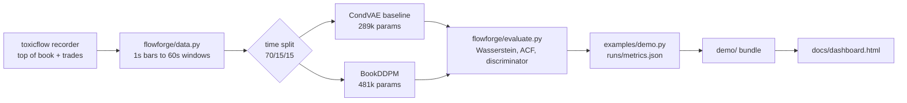
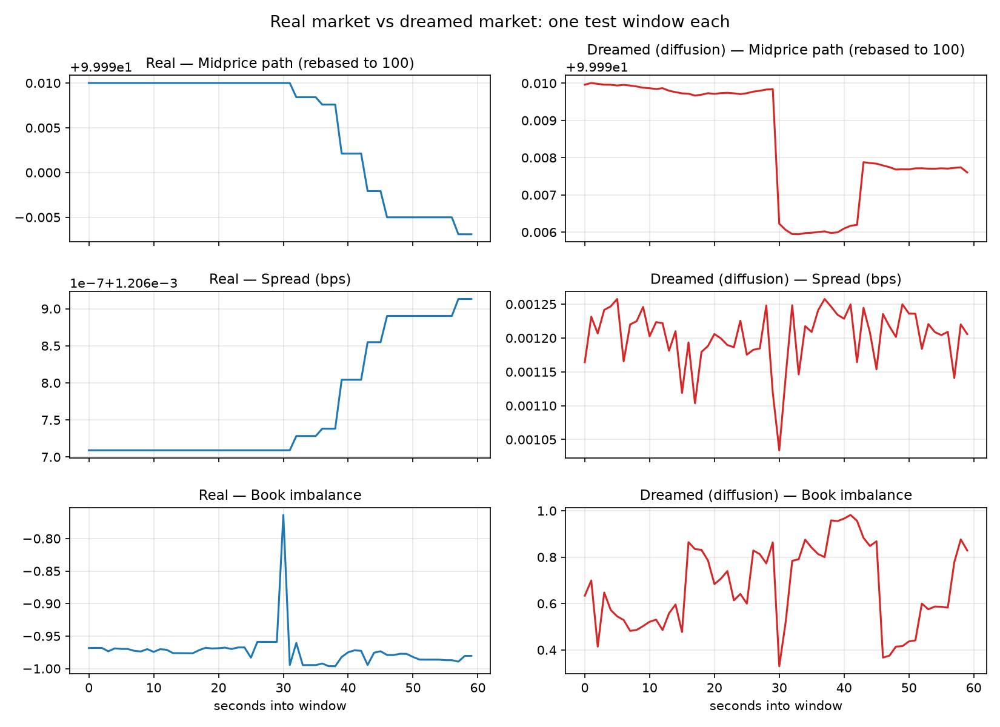
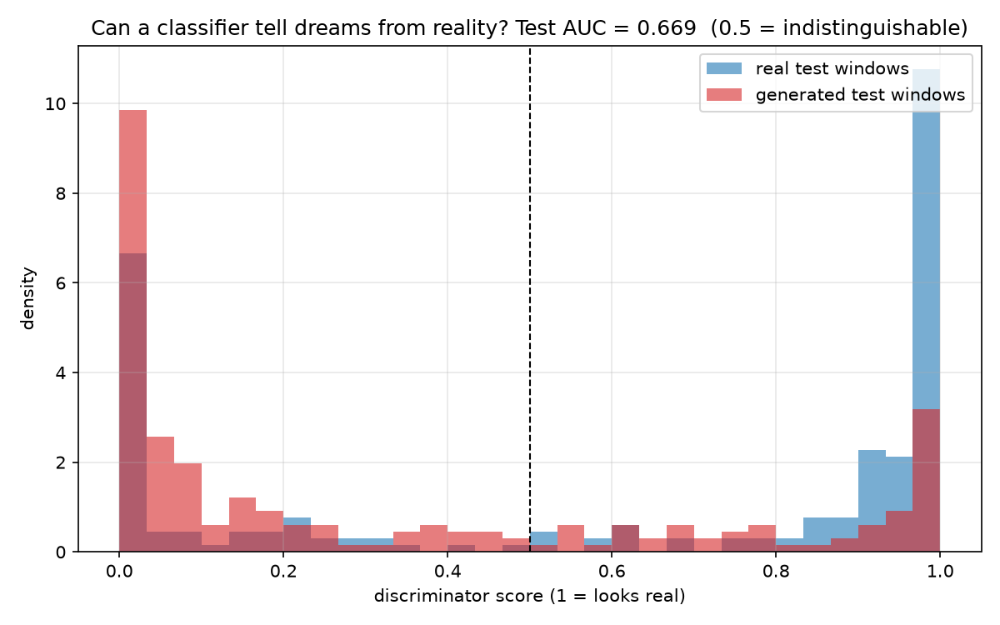

# FlowForge


**Teach an AI what a real market looks like, then ask it to dream up new ones.**

A limit order book is the waiting list of a market: who wants to buy, who wants to sell, at what price, in what size, updating thousands of times a second. I recorded about four hours of the real one for BTCUSDT, cut it into one minute windows, and trained generative models to produce new windows from scratch. Then I measured, honestly, how close the dreams come to reality.

This is simulation research. Nothing here trades, connects to a trading endpoint, or touches real money. The point is the generator and the measuring stick, not a strategy.

## Live interactive demo

[](https://faiyazenayet.github.io/FlowForge/docs/dashboard.html)

**[Open the interactive dashboard](https://faiyazenayet.github.io/FlowForge/docs/dashboard.html).** Flip through real vs dreamed market windows, inspect the discriminator scores, and read the full evaluation tables. It is one self-contained HTML file, so it runs anywhere and is ready for GitHub Pages. The animation above is rendered from the same data by `examples/make_gif.py`.

## How it works



**Data.** My toxicflow recorder saves the top of the book (best bid and ask with sizes) ten times a second, plus every trade with its aggressor side. Eight thirty minute sessions gave 14,378 seconds. I turn each second into one state vector: log return of the midprice, spread, log sizes, book imbalance, signed trade volume, trade count. Sixty seconds make one window. Windows are split by position on the concatenated recording timeline, first 70 percent train, next 15 percent validation, last 15 percent test, and a window that straddles a boundary is dropped. The generator never sees validation or test. Standardization uses train statistics only. Sessions recorded hours apart would break a wall-clock split, so concatenation keeps every split populated while staying strictly chronological.

**Models.** Two, both conditioned on regime features (recent volatility and spread, computed strictly from the past before each window):

- A conditional VAE baseline, 289k params. Small on purpose. It is the thing to beat.
- A DDPM diffusion model, 481k params. A 1D conv net learns to remove noise from a window over 100 steps, conditioned on the diffusion timestep and the regime. Sampling uses EMA averaged weights, which proved to be the single biggest quality win. One real bug caught along the way: my first noise schedule never reached pure noise at the last step, so sampling started from the wrong distribution and every generated window came out under dispersed. The code now asserts the schedule actually reaches noise.

**Evaluation.** This is the deliverable. On the held out test split:

1. Marginal distributions. For each of the seven features: real vs generated mean, std, and 1-Wasserstein distance.
2. Temporal structure. Autocorrelation of signed order flow at lags 1 to 5. In this sample the real flow is near zero at one second bars, so the check is whether the generator reproduces that flatness instead of inventing structure.
3. A discriminator test. Train a classifier on validation windows (real vs generated) and report its AUC on test windows the generator never saw. Fixed seeds. AUC near 0.5 means the dreams are indistinguishable.

Every metric was sanity checked on synthetic inputs with known answers first: Wasserstein of identical distributions is ~0 and of N(0,1) vs N(2,1) is ~2, autocorrelation recovers 0.8 on AR(1) data, the discriminator scores ~0.5 on identical distributions and ~1.0 on separated ones. If a check had failed I would have fixed the metric, not the test.

## What I found

Real numbers from `examples/demo.py`, seed 7, about 11 minutes of CPU training (timing varies with hardware). Eight thirty minute sessions, 14,378 seconds of book data, 937 train windows, 199 validation, 198 test. The diffusion model: 481k params, 300 epochs, EMA weight averaging for sampling. The VAE baseline is unchanged.



The diffusion model beats the VAE clearly. Mean Wasserstein distance across features: 0.276 vs 0.536. Discriminator AUC on the held out test split: 0.669 vs 0.937. The VAE still collapses to conditional means, generating a fraction of the real variance. The diffusion model matches variances far better and reproduces the flat autocorrelation of signed order flow that the real data shows.



Two gaps closed since the first version. The discriminator AUC fell from 0.734 to 0.669: the classifier still separates dreams from reality, but noticeably worse than before. The imbalance mean shift shrank from 0.52 to 0.17 in standardized units. What worked: longer training, EMA sampling weights, a larger denoiser, and two extra hours of recordings from a different time of day. What did not move the needle much on its own: model size without EMA.

## Quickstart

```bash
python3 -m venv .venv && .venv/bin/pip install torch --index-url https://download.pytorch.org/whl/cpu
.venv/bin/pip install -r requirements.txt

# build windows from toxicflow recordings (data/ is gitignored, rebuild it)
PYTHONPATH=. .venv/bin/python examples/build_data.py ~/workspace/toxicflow/data/chunk1 .../chunk8

# train both models and print the full evaluation
FF_DDPM_CH=128 FF_DDPM_BLOCKS=4 FF_DDPM_EPOCHS=300 FF_DDPM_EMA=0.999 \
  PYTHONPATH=. .venv/bin/python examples/demo.py

# tests, including the metric sanity checks
PYTHONPATH=. .venv/bin/python -m pytest tests/ -q
```

No data and no GPU? Open `docs/dashboard.html` in a browser. It is prebuilt from a small committed sample under `demo/`, so it works with nothing installed. To rebuild it after a fresh `demo.py` run: `PYTHONPATH=. .venv/bin/python examples/build_demo.py && PYTHONPATH=. .venv/bin/python examples/build_dashboard.py`.

## What is in here

- `flowforge/data.py`: parquet to standardized windows, concatenated timeline splits, overlap guard, leakage discipline documented in the docstring.
- `flowforge/models.py`: conditional VAE baseline and the DDPM (1D conv denoiser, regime conditioning, validated noise schedule, EMA sampling weights).
- `flowforge/evaluate.py`: Wasserstein distances, autocorrelation, the held out discriminator with fixed seeds, plus a printable report.
- `flowforge/demo.py`: loader and plotting helpers for the committed demo bundle, shared by the dashboard and GIF scripts.
- `examples/demo.py`: end to end training and evaluation. `examples/build_data.py`: rebuild the window dataset. `examples/build_demo.py`: freeze the small `demo/` bundle. `examples/build_dashboard.py`: render `docs/dashboard.html`. `examples/make_gif.py`: render `docs/demo.gif`. `examples/sweep.py`: model config sweep on the validation split. `examples/figures.py`: the real vs dreamed plots.
- `demo/`: precomputed sample (64 real + 64 generated windows, discriminator scores, metric tables) that ships with the repo so the dashboard works from a fresh clone.
- `docs/dashboard.html`: the interactive dashboard as one self-contained HTML file. `docs/demo.gif`: the animated preview, rendered from the same bundle.
- `tests/`: 34 tests. Shapes, NaN handling, no time overlap between splits, EMA roundtrips, every metric checked against synthetic inputs with known answers, and the demo bundle loader.

## Honest limitations

- The discriminator still wins at 0.669. The dreams are good, not perfect.
- Book sizes are the hardest feature: the generator underplays their variance.
- Spread is nearly a point mass in this data (BTC spread pinned at one tick), which mostly tests whether the generator reproduces that.
- Two evenings of BTCUSDT spot: one asset in one mood. Different regimes would give different numbers, and one volatile session would teach the model things this calm data cannot.
- The recorder saves only the touch, not full depth, so the model learns top of book dynamics only.
- Small models on CPU, four hours of one asset. This is a proof of concept, not a production simulator.
- Research code, not trading advice. Nothing here should touch real money.
