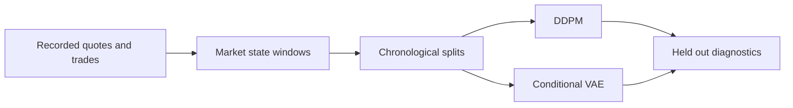

<p align="center"></p>

<h1 align="center">FlowForge</h1>

<p align="center">
  <a href="https://github.com/FaiyazEnayet/FlowForge/actions/workflows/ci.yml"></a>
  
  
  
</p>
<p align="center">
  <a href="https://faiyazenayet.github.io/FlowForge/docs/dashboard.html"></a>
  <a href="#method"></a>
  <a href="#run-locally"></a>
</p>

FlowForge generates short market-state sequences from recorded BTCUSDT data and tests how closely a model can reproduce observed market behavior. The result is synthetic data evaluated on the behavior it captures, with distributional and temporal checks that go well beyond a plausible price trace.


<p align="center"><a href="https://faiyazenayet.github.io/FlowForge/docs/dashboard.html"></a></p>


Useful synthetic market data preserves local behavior alongside distributional and temporal structure. The sequence explorer connects all three views, so marginal fidelity and market dynamics can be read together in one place. Real and generated windows are independently sampled and compared by their relative time offsets.

## Explore

- Select observed and generated windows independently and inspect them at a synchronized time cursor.
- Compare midprice, spread and imbalance, with synthetic sequences clearly labeled alongside real observations.
- Read marginal fidelity, discriminator and temporal diagnostics together.

## Method

Top-of-book quotes and signed trade flow become standardized windows. A regime-conditioned DDPM is evaluated against a conditional VAE using held-out discriminator tests, feature distributions, temporal autocorrelation and downstream prediction.

## Evidence at a glance

| Scope | Recorded result or contract |
| :--- | :--- |
| Recorded data | 14,378 seconds across eight sessions (3.99 hours, one BTCUSDT recording span) |
| Train / validation / test windows | 996 / 168 / 168 under the current session-disjoint split |
| Mean Wasserstein distance | DDPM 0.276; VAE 0.536 |
| Held-out discriminator AUC | DDPM 0.669; VAE 0.937 |
| Downstream direction task | DDPM-trained accuracy 0.626, equal to the majority baseline; VAE-trained 0.409 |

## Updating this project

Dashboard source language: **Python**. Generator: `examples/build_dashboard.py`. The local interactive output is `docs/dashboard.html`.

## Run locally


```sh
python -m pip install -r requirements.txt
python -m pip install -r portfolio_ui/requirements.txt
python -m pytest tests -q
python examples/build_dashboard.py
```

## Technical design

Seven features describe each market-state window: log midprice return, transformed spread, bid and ask size, imbalance, signed flow and trade count. Regime conditioning uses a past lookback rather than the target window. The generator standardizes with training statistics and compares diffusion with a compact VAE baseline.



The denoiser is selectable: alongside the default convolutional stack, the model offers a dilated TCN, a compact 1-D U-Net and an attention variant, all held to the same parameter budget. An ablation harness (`examples/architecture_ablate.py`) measures theoretical and empirical receptive fields and compares the architectures in a single paired run. In that comparison the metrics split across fidelity, discrimination and validation loss, and that split supports a clear decision: the convolutional stack remains the default.

## Evaluation protocol

Splits are session-disjoint: whole recording sessions go to train, validation, or test, never split across them (six sessions train, one validation, one test). No raw second appears in more than one split by construction. Each session stands as its own segment, and the eight sessions together form consecutive ~30-minute recordings from a single ~5.6-hour span, which sets the scope for the evaluation. Evaluation asks separate questions about marginal distributions, temporal dependence, distinguishability and downstream utility, and answers each one on its own terms.

The model metrics below come from the previous split policy, and the next full retrain brings them onto the current split, building on the comparison layer described here.

The comparison layer is built for a rigorous headline comparison. Block resampling and the VAR baseline respect session and segment boundaries, so no copied block or fitted lag crosses a recording break, and every copied window traces back to a training index. Alongside the VAE, the DDPM also faces a regime-matched chunk-copy baseline (copy the training block whose regime is closest to the target regime) and a lightweight conditional autoregressive comparator. All of them are scored under identical test conditions with repeated seeds and full latency and cost accounting. Wasserstein differences, discriminator AUC, and downstream TSTR differences carry block-bootstrap intervals at several block lengths; with a single test session, those intervals provide within-session evidence, ready to extend across days as more sessions are recorded.

The table above brings together two recorded populations: the recorded bundle (demo/metrics.json) reports 937 / 199 / 198 windows from the earlier study, while 996 / 168 / 168 is the current split population. The two studies also used different DDPM capacities (221,767 versus 480,775 parameters), so each set of figures stands as its own study, reported side by side for reference.


The diffusion result improves on the VAE in mean Wasserstein distance, and the held-out discriminator result shows how far that fidelity carries toward observations. The downstream direction task sits at the majority baseline level, which establishes a clear separation the design makes explicit: distributional fidelity and downstream predictive information measure different things, and FlowForge reports each one directly.

## Code and data

`flowforge/data.py` owns window construction and split discipline. `flowforge/models.py` defines the VAE and DDPM. `flowforge/evaluate.py` owns the evaluation. `demo/` contains the compact recorded result bundle.


## Limitations

- The sample covers a focused BTCUSDT recording period and top-of-book data, which together define the current scope.
- Generated windows are distinguishable from held-out observations at the measured discriminator level. Marginal distance is one measure among the distributional, temporal and downstream checks reported here, and each check is reported on its own terms.
- Small recording gaps are handled on a strict 1-second grid: a new segment starts at every missing second, the bar after a gap is dropped so no log return ever spans more than one second, and every 60-row window covers exactly 59 seconds of elapsed time.

## License

[MIT](LICENSE). Third-party datasets, libraries and fonts retain their own terms.
